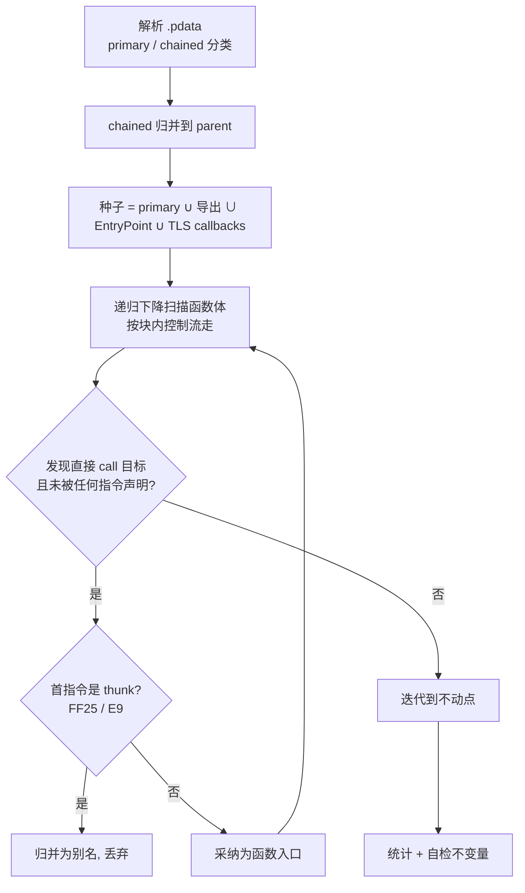

# 无 PDB 的 PE x64 函数枚举方案

## 1. 文档目的与适用范围

在没有 PDB / 调试符号时，给出二进制的**函数入口集合**（不是 unwind 区域集合），作为下列用途的节点集：

- 签名库 / symmatch 的目标集合
- 调用图（call graph）的节点与边端点
- 「锚点 → 目标最小路径」recipe 的节点

适用范围：

| 项 | 取值 |
|---|---|
| 格式 | PE x64（MSVC 或 MinGW 均可，差异见 §9） |
| 前提 | 有 `.pdata`（`IMAGE_DIRECTORY_ENTRY_EXCEPTION`） |
| 不在范围 | **32 位 PE**：没有 `.pdata`，实测递归下降只覆盖 11.6 % 的 `.text`（见 §6.4） |
| 不要求 | 不要求 PDB、不要求导出表完整、不要求 `AddressOfEntryPoint` 可达 |

## 2. `.pdata` 的语义（必须先对齐）

`RUNTIME_FUNCTION{ BeginAddress, EndAddress, UnwindInfoAddress }` 描述的是**一段拥有单一 prologue 的连续代码（unwind 区域）**：

- 它**不是基本块**：一个 range 内部可以有几十个基本块，这些块没有自己的条目。
- 它**不会把一个函数切碎**：任意两条 range 互不重叠（实测 5 个 DLL + DST 两个 exe，重叠数恒为 0）。
- 条目开头有两种身份：

| 身份 | 判定（按此顺序） |
|---|---|
| 函数入口 primary | `UnwindData == 0`（无 unwind 信息的 leaf） |
| indirect 片段 | `UnwindData & 1 == 1`：`UnwindData` 本身指向**另一条** `RUNTIME_FUNCTION`（`& ~1` 后取该条目的记录，再重新分类） |
| 同函数片段 chained（冷路径 / SEH funclet / separated code） | `unwind_info[0] & 0x20 != 0` |
| 函数入口 primary | `unwind_info[0] & 0x20 == 0` |

**常见错误**：`(unwind_info[0] & 0x07) == 4` 是 **Version 字段**（恒为 1），不是 `UNW_FLAG_CHAININFO`。用错会把冷片段当成独立函数，分母直接翻倍（`lua51DS.dll`：1185 primary 变 2120）。

### 2.1 chained 归并到 parent

`CHAININFO` 的 `UNWIND_INFO` 在头部之后内嵌一个完整的 `RUNTIME_FUNCTION`，其 `BeginAddress` 就是 parent：

```c
static uint32_t parent_of(uint32_t unwind_rva) {
    const uint8_t *h = read(unwind_rva, 4);
    uint32_t n = h[2];                       // CountOfCodes
    uint32_t off = 4 + 2 * n + (n % 2 ? 2 : 0);   // 结构按 DWORD 对齐
    const uint32_t *par = (const uint32_t *) read(unwind_rva + off, 12);
    return par[0];                           // parent.BeginAddress
}
```

多级链（parent 也是 chained / indirect）需要迭代到根。**跳数只数父转移**：`kMaxChainHops = 8` 表示 8 次父转移仍然解析成功（第 9 次即判孤儿），起始记录本身不算一跳。环、断链、以及「内嵌父副本与该 parent 自己的 `.pdata` 记录不一致」三种情况都按孤儿处理：片段仍然保留字节（不重复扫描），但永不命名入口。

实测：DST 客户端 10,026 条 chained **100 %** 归并成功、0 孤儿；开发期 DLL 有 15/146 孤儿（多级链或父被 ICF 折叠）。

## 3. 算法



### 3.1 步骤

1. **解析**：按 12 字节步长读 `.pdata`；目录长度不是 12 的倍数说明尾部有半条 `RUNTIME_FUNCTION`，按**损坏**处理（整份枚举失败），而不是静默截断。随后按 §2 的顺序分类，建立 `BeginAddress → 规范记录` 与 `record RVA → 规范记录` 两张表（同一条记录被多个间接条目引用时，每个 RVA 都保留映射）；记录必须整体落在**同一个可执行 section** 内，否则跳过（端点检查会把跨非执行段的记录当成函数，从而把空洞发布成代码）。
2. **归并**：每条 chained / indirect 迭代到 primary 父（indirect 先取 `UnwindData & ~1` 指向的记录再分类）；`fragment_end[start] = 自己的 EndAddress`。超出跳数、成环、断链都记为孤儿。
3. **种子**：`.pdata` primary ∪ 导出表 RVA ∪ `AddressOfEntryPoint` ∪ TLS callbacks（`.tls` 目录 `AddressOfCallBacks` 指向的以 0 结尾的指针数组）。
4. **递归下降**（见 §3.2）：函数体用**块内工作栈**扫，不是线性扫到第一个 `ret` 就停。
5. **采纳**：直接 `call` 的 imm 目标，若（a）不在任何已声明指令地址上，（b）在可执行 section 内，（c）首指令不是 thunk，（d）**不落在任何已发布的函数体内部**，则作为新函数入口入队。（d）是必需的：函数体内可能有分支没走到的字节（跳过的 padding、`jcc` 之间的空隙），那些字节属于该函数，不是新函数。
6. **拒绝 thunk**：首指令 `FF 25`（`jmp [rip+IAT]`）或 `E9`（`jmp rel32` 别名）一律不进入函数集，只用于追真身。**这一步是 precision 的全部来源**（见 §6.1）。追真身必须是三态判定：槽位不可读、槽位为 0（惰性绑定）、`FF 25` 的位移不可解，都整条入口作废——六个字节的跳板绝不当作函数体（把它当函数会得到一个只有 6 字节的假函数，且真身被它遮住）。
7. **迭代到不动点**：采纳出的函数体继续扫，直到没有新入口。
8. **统计 + 自检**（§7）。

### 3.2 递归下降的伪代码

```cpp
void walk(uint32_t start, uint32_t end, uint32_t owner) {
    std::vector<uint32_t> work{start};
    while (!work.empty()) {
        uint32_t pc = work.back(); work.pop_back();
        for (;;) {
            if (claimed.contains(pc) && claimed[pc] != owner) break;  // 撞到别的函数
            if (pc >= end || !in_exec(pc)) break;
            auto ins = decode_one(pc);
            if (!ins) break;                                          // 非法字节
            claimed[pc] = owner;
            switch (classify(ins)) {
            case Call:
                if (is_direct(ins) && in_exec(target(ins)))
                    add_callee(target(ins), pc);                      // 记录边 + 候选入口
                pc += ins.size; break;
            case Jmp:
                if (is_direct(ins) && start <= target(ins) && target(ins) < end
                    && !claimed.contains(target(ins)))
                    work.push_back(target(ins));                      // 块内跳转
                goto next_block;                                      // 无条件 jmp 结束本块
            case Jcc:
                if (is_direct(ins) && start <= target(ins) && target(ins) < end
                    && !claimed.contains(target(ins)))
                    work.push_back(target(ins));                      // 双分支
                pc += ins.size; break;
            case Ret: case Trap:                                      // ret/iret/int3/hlt/ud2
                goto next_block;
            default:
                pc += ins.size; break;
            }
        }
    next_block:;
    }
}
```

要点：

- **无条件 `jmp` 必须结束当前块**（否则会把下一个函数当成本函数的延续）。
- **`jcc` 双入队**：不跟随分支会漏掉半个函数体，进而漏掉一半调用边（实测指令数 518k → 756k）。
- **`call` 之后继续**（fall-through），不是结束。
- **`int3` 也是块终止符**（MSVC 用它做函数间填充）。

### 3.3 函数体边界（end 的来源）

区间一律**半开** `[start, end)`：`end` 是最后一条指令之后的第一个字节，`containing(end)` 不命中。

| 函数来源 | end |
|---|---|
| `.pdata` primary | 该条目的 `EndAddress`（精确） |
| chained fragment | 片段自己的 `EndAddress`，指令归属到 parent |
| 采纳的入口（无 unwind） | 本次扫描声明到的最远指令尾；从未解码出一条指令则不入表 |
| 32 位 | 无 `.pdata`，只能靠 `claimed` 冲突与上限截断（不推荐，见 §6.4） |

安装时的两道几何约束：

- 入口 `start` 必须落在 `.text` 的半开区间 `[base, base+size)` 内（`start == base+size` 没有可解码字节，不能发布）；
- 函数体按 `.text` 截断，`size = min(end, text_end) - start`，扫描器永远不走出 `.text`。

## 4. 终止条件汇总

| 条件 | 行为 |
|---|---|
| `ret` / `retf` / `iret` | 结束当前块 |
| `int3` / `hlt` / `ud2` | 结束当前块 |
| `jmp far`（`FF /5`，LJMP） | 结束当前块（64 位模式下无 fall-through） |
| 无条件 `jmp`（直接、落在本函数内） | 目标入队，结束当前块 |
| 无条件 `jmp`（落到界外） | 结束当前块（尾调用，不采纳为入口） |
| 条件跳转（直接、落在本函数内） | 目标入队，继续 fall-through |
| `call`（直接） | 记录边与候选入口，继续 |
| 非法字节 | 结束当前块 |
| 命中其他函数已声明的地址 | 结束该函数扫描 |
| 走出可执行 section | 结束 |
| 已声明 200,000 条指令 | 硬熔断（在声明第 200,001 条**之前**停止；同一 owner 的后续片段不再重新扫描） |
| 采纳轮数 > 8 | 硬熔断 |
| chained 父转移 > 8 | 该片段记孤儿 |

## 5. 落库位置（本仓库）

| 环节 | 现有代码 | 说明 |
|---|---|---|
| 平台分派 | `src/FunctionRelocation/FunctionRanges.cpp`（`discover_module_functions`） | PE x64 / ELF FDE / Mach-O function starts 三选一，成功后才安装函数表 |
| PE 入口枚举 | `src/FunctionRelocation/FunctionDiscovery.cpp`（`discover_pe_x64`） | §2–§4 全部步骤：`.pdata` 分类与归并、种子、递归下降、thunk 拒绝、分轮采纳 |
| 函数表 | `src/FunctionRelocation/FunctionTable.hpp` | primary span 表 + 冷片段（`FunctionFragment`，`owner`）二分索引 |
| 反汇编 | frida-gum 的 capstone（`Frida::Gum`，`get_ctx().hcs` + `CS_OPT_DETAIL`） | 静态与运行期同一解码器、同一 `cs_insn` 分配 |
| thunk 解析 | `CallTargetResolver.cpp`（`resolve_pe_discovery_target`） | 仅追 `E9 rel32` / `FF 25 [rip+disp32]`，最多 8 跳；图匹配用的 `resolve_call_target` 共用同一步解码 |
| ELF | `FunctionRanges.cpp`（`enumerate_function_ranges_elf`） | libdwarf `dwarf_get_fde_list_eh` + PT_LOAD load bias，同一起点保留最长 FDE |
| Mach-O | `FunctionRanges.cpp`（`discover_macho`）+ `decode_macho_function_starts` | 优先 Frida 私有 `gum_*_module_enumerate_function_starts`（CMake 探测实际 devkit），否则解析加载后的 `LC_FUNCTION_STARTS`；ULEB128 以映像基址累加 |
| 安装 | `ModuleSections.cpp`（`detail::install_function_spans`） | 一个入口一个 `Function`（`size = end - start`），按 `symbol_names` 赋名 |

约束：静态与运行期必须使用**同一份** thunk 归并与 rel32 解码逻辑，否则「第 k 个直接转移」的 ordinal 会漂移；运行期只安装 `.text` 内的入口（以及其 primary 在 `.text` 内的片段），签名匹配器始终只看单段 `.text`。

## 6. 实测数据

### 6.1 有真值时的标定（`lua51Original.dll`，PDB 提供 807 个非 IAT-thunk 函数）

| 策略 | 产出 | recall | precision |
|---|---|---|---|
| `.pdata` primary 当函数表 | 650 | 79.8 % | **99.1 %** |
| ＋采纳未被覆盖的 call 目标 | 974 | 84.1 % | 69.7 % |
| **＋拒绝 thunk（FF25 / E9）** | **688** | **84.1 %** | **98.7 %** |
| ＋再采纳 jmp 目标 | 844 | 84.9 % | 81.2 % |
| ＋无门控采纳所有取址入口 | 1013 | 86.7 % | 69.1 % |

「拒绝 thunk」一步跳过了 1,367 个候选，是 precision 从 69.7 % 回到 98.7 % 的全部原因。残差 16 % 是无 unwind 的小访问器（`mov rax,[rcx+..]; ret`），只被 `luaL_Reg` 注册函数调用，而后者唯一进入点是脚本。

### 6.2 DST 实测（r759671 构建，MSVC x64，无本地 PDB；Python 参考实现）

| 指标 | `dontstarve_steam_x64.exe` | `dontstarve_dedicated_server_nullrenderer_x64.exe` |
|---|---|---|
| `.pdata` 条目 | 24,407 | 22,460 |
| primary / chained | 14,381 / 10,026 | 13,184 / 9,276 |
| chained 归并 / 孤儿 | 10,026（100 %）/ 0 | 9,276（100 %）/ 0 |
| 最终函数集合 | **16,052** | 14,796 |
| 其中采纳 | 1,669（10.4 %） | 1,610 |
| 反汇编指令数 | 1,130,590 | 1,020,088 |
| `.text` 指令覆盖 | 92.2 % | 92.0 % |
| `.pdata` range 覆盖 `.text` 字节 | 94.4 % | ≈94 % |
| distinct 直接调用目标 | 10,464 | 9,680 |
| 有 ≥1 直接调用者 | 10,211（63.6 %） | 9,457（63.9 %） |
| 0 直接调用者 | 5,841（36.4 %） | 5,339 |
| thunk 形状的 primary | 0 | 0 |
| 耗时（Python 单线程参考实现） | 5.7 s | 5.2 s |

### 6.2.1 仓库内 C++ 实现（`signature_updater create` + `DS_FR_LOG=1`，RelWithDebInfo）

| 指标 | 客户端 exe | 专服 exe | `Mod/deps/lua51.dll` |
|---|---|---|---|
| `.pdata` primary | 14,381 | 13,184 | 606 |
| chained 归并 / 孤儿 | 10,026 / 0 | 9,276 / 0 | 189 / 0 |
| 无 unwind 种子（导出 + 入口点 + TLS） | 2 | 2 | 26 |
| 采纳 | 1,689 | 1,631 | 60 |
| **最终入口数** | **16,070** | **14,815** | **666** |
| 被声明的 `.text` 字节 | 4,605,649 | 4,157,860 | 111,044 |
| 预算熔断 | 0 | 0 | 0 |

发现阶段耗时 527 ms（客户端）/ 430 ms（专服）/ 56 ms（`lua51.dll`）。两个 exe 的 TLS 目录都不可用（`unusable TLS callback table`），所以种子只剩 `AddressOfEntryPoint` 与 2 条导出。

### 6.3 `.text` 空洞分类（客户端，`.pdata` range 之外；Python 参考实现）

| 分类 | 字节 | 占比 |
|---|---|---|
| 空洞合计 | 276,718 | 5.6 % |
| 纯 padding（`0xCC`/`0x00`） | 92,603 | 1.9 % |
| **真实代码（无 unwind）** | **133,032** | **2.69 %** |
| 解不出指令（跳表/字面量） | 35,853 | 0.7 % |

这 2.69 % 正是采纳的 1,669 个函数的身体。也就是说：`.pdata` 的「漏」在这两个 exe 上按字节只有 2.7 %，按函数数约 10 %。

### 6.4 32 位反例（不推荐）

`bin/dontstarve_steam.exe` 没有 `.pdata`：同一套递归下降只得到 **2,372 个函数、11.6 % 的 `.text`**，入口是 `call thunk; jmp __scrt_common_main_seh`（向后跳），主体靠 vtable 分派。32 位必须改用「导出 + `.data` 函数指针表作种子 + 取址分析」。

## 7. 无真值时的自检不变量

| 不变量 | DST 实测 |
|---|---|
| 任意两函数的指令集不相交 | 成立（`claimed` 构造保证） |
| 每个采纳入口至少 1 个引用者 | 1,669/1,669 |
| 每个 primary 都是解码起点 | 成立（从其开始解码） |
| 未归属代码占比可量化且可解释 | 2.69 % 真实代码 + 1.9 % padding + 0.7 % 数据 |
| 已知导出的 RVA 落在函数集内 | 成立**但有三条前提**：EAT 整表须在映像内、条目不是转发器（RVA 落在导出目录内）、不是非可执行 RVA；入口若是 `E9`/`FF 25` 跳板则先追到真身，且该跳板本身若不是 `.pdata` primary 就不在函数集里 |

## 8. 不能当判据的东西（真值上验证过）

| 判据 | 反例 |
|---|---|
| 16 字节对齐 | `lua51Original` 140/796 条未对齐；按它过滤只去掉 1 个真函数 |
| `SizeOfProlog == 0` ⇒ 非函数 | 73/796 条为 0，全是真函数 |
| 区间 ≤ 8 字节 ⇒ thunk | 11 条里只命中 1，其余是 SEH funclet |
| 区间重叠去重 | 重叠恒为 0，去重无意义 |
| 导出 = 函数入口 | 里面有 label（LuaJIT `lj_BC_*` 落在 18 KB `lj_vm` 内）、数据符号、IAT thunk |
| PDB 的 `addr = sec:offset` 按 hex 解析 | offset 是**十进制**；按 hex 解析时 465 个函数只有 1 个对得上 |

## 9. 已知边界与后续提升

1. **36.4 % 的函数没有直接调用者**（DST）。它们经 vtable / 回调表 / `luaL_Reg` 进入，静态上需要额外的边类型：
   - 代码→函数取址（`lea rax,[rip+fn]`）：把回调目标接上；
   - 代码→数据表槽→函数（两跳）：虚表 / 注册表；
   - 这一步对更深的目标覆盖率是唯一有效手段，继续改反汇编无收益。
2. **MinGW**：chained 比例高（`lua51DS` 935/2120），`lj_vm` 内部有 3,557 个 call/jmp 落点是区间**内部标签**（`lj_BC_*`），必须归 owner，绝不能当新函数。
3. **ELF**：`.eh_frame` FDE 边界（比 `.dynsym` 全）直接当入口集合，不需要递归下降——未登记 FDE 的汇编函数（无 `.cfi_startproc`）不会成为入口，这是本方案在 ELF 上的已知缺口；macOS 同理，只有 `LC_FUNCTION_STARTS` 里的地址才是入口。
4. **若日后有 PDB**：`dbghelp` / `SymEnumSymbols` 优先，PDB 只作 cross-check。注意 PDB `S_THUNK32` 记录的 import thunk 不是函数。

## 10. 参考实现参数

| 参数 | 取值 | 说明 |
|---|---|---|
| 每次解码块大小 | 2,048 B | 减少 `disasm` 调用次数 |
| 采纳入口的 end 上限 | `+0x8000` | 没有 unwind 信息时的保护（与「下一个已知入口」取小） |
| chained 父转移上限 | 8 | 多级链 / indirect 链；只数父跳转 |
| 采纳轮数上限 | 8 | 不动点前的熔断 |
| 单 owner 指令上限 | 200,000 | 在声明第 200,001 条之前停止；同一 owner 的后续片段直接跳过 |
| 解码器 | capstone 5.x，`CS_MODE_64`，`disasm_lite` 足够（只需要助记符 + 操作数字符串） | 需要操作数细节时用 detail 模式 |

参考实现（Python 单文件）在上述参数下对 7 MB 的 DST 客户端耗时 **5.7 s**；移植到 C++（capstone C API + 本仓 `FunctionRanges`）预计 **0.2–0.5 s**。
